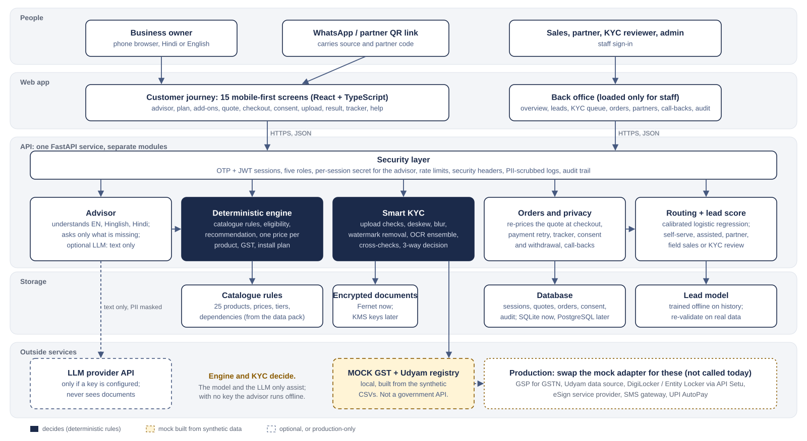

# Architecture

`architecture.svg` is drawn by `build_svg.py`; `architecture.mmd` describes the same components and links in Mermaid
(rendered as `architecture_mermaid.svg`). Both match the code in this repository; nothing on the diagram is planned
unless it is drawn dashed and labelled so.

## Shape: a modular monolith

One FastAPI service, one React app, one database. Each box in the API lane is a Python package with its own tests and
no knowledge of HTTP:

| Module | Code | Responsibility | Decides or assists |
|---|---|---|---|
| Security layer | `app/security.py`, `app/audit.py`, `app/main.py` | OTP + JWT sessions, five roles, advisor session secret, rate limits, security headers, PII-scrubbed logs, audit trail | enforces |
| Advisor | `app/advisor/` | Turns the owner's words (English, Hinglish, Devanagari) into a validated business profile; asks only for what is missing; optional LLM adapter | assists |
| Deterministic engine | `app/domain/` | Catalogue rules, eligibility, recommendation, quantities, one published price per product, GST, contract term, install schedule | **decides** |
| Smart KYC | `app/kyc/` | Upload checks, deskew, blur and watermark handling, OCR ensemble, field validation, registry cross-checks, duplicate detection; returns verified / action needed / human review | **decides** (a person decides every review case) |
| Orders and privacy | `app/routers/commerce.py`, `app/routers/kyc.py`, `app/orders.py`, `app/consent.py` | Server re-pricing at checkout, payment retry, tracker, consent and withdrawal, call-backs | enforces |
| Routing + lead score | `app/domain/routing.py`, `app/ml/` | Calibrated propensity score with per-lead drivers; routes each lead or order to self-serve, assisted digital, partner, field sales or KYC review with an SLA | assists (ranks who to call; never price, eligibility or KYC) |

Why a monolith: the prototype's load is a few thousand leads a quarter, the modules share one data model, and a single
deployable keeps transactions simple (an order, its quote, its KYC case and its audit events are written together).
The module boundaries are where services would be split later: KYC first (bursty CPU load from OCR, stricter data
handling), then lead scoring.

## The trust boundary that matters most

Every number a customer pays and every eligibility or KYC outcome comes from deterministic code that is covered by
tests, including a cross-check against the 56 historic bundles that broke the catalogue rules. The language model,
when a key is configured, can only:

1. propose profile fields from the owner's text; they are validated by the same schema as the form, and the offline
   extractor's exact matches (numbers, GSTINs) win over the model; and
2. rephrase the plan explanation; the rewrite is accepted only if it mentions no product or price that is not in the
   plan, otherwise the template text is used.

The model receives text with identifiers masked, never documents, and the journey works the same with no key.

## Request flow (customer journey)

1. Advisor session: `POST /api/advisor/sessions` returns an id and a secret; each message updates the profile.
2. When the five required facts are known (business type, city, people, sites, GST status), the engine recommends a
   plan and a lower-cost Starter option, prices them and explains each line.
3. Add-on changes are re-priced by the server (`/api/quotes/preview`); a saved quote holds its price for 15 days.
4. Checkout needs an OTP-verified mobile; the server recomputes the quote from the catalogue, so a tampered client
   price has no effect.
5. KYC starts only after itemised consent; each document is validated, re-encoded and stored encrypted; the checks
   produce a decision with reasons in the customer's language.
6. The tracker shows milestones with expected dates; stalls and call-back requests route to people with an SLA.

## Production path

| Prototype | Production |
|---|---|
| SQLite (WAL) | PostgreSQL with point-in-time recovery |
| Fernet with a key from the environment | Object storage with envelope encryption, keys in a KMS / HSM |
| In-memory rate limiter | Redis or the API gateway |
| Mock GST / Udyam registry (synthetic CSVs) | GST Suvidha Provider for GSTN data; an authorised Udyam source; DigiLocker / Entity Locker via API Setu (requires approval) |
| On-screen demo OTP | SMS gateway with DLT-registered templates |
| Simulated payment | Payment gateway with UPI AutoPay mandates |
| Demo staff passwords | SSO with MFA; access reviews |
| Tesseract on the API host | Separate OCR worker queue; re-measure on real phone photos |

Swapping the registry is a one-class change: `MockRegistry` and `UnavailableRegistry` implement the same
`gstin()` / `udyam()` interface in `app/kyc/registry.py`, and the checks already handle an unavailable registry by
sending the case to a person instead of failing.
